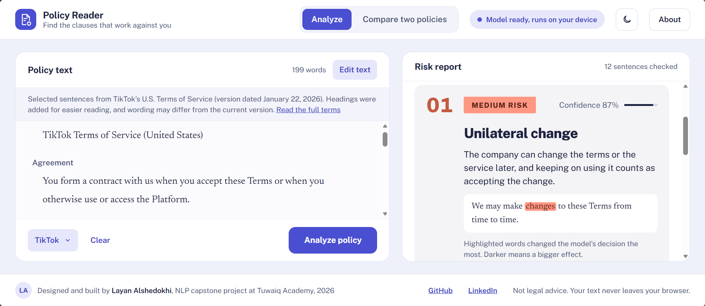

# Policy Reader

**Find the clauses in a Terms of Service that work against you.**

Policy Reader reads a Terms of Service sentence by sentence and highlights clauses that consumer law often treats as unfair: for example, the company closing your account without a reason, changing the rules whenever it wants, or making you give up your right to go to court. It is powered by a fine-tuned RoBERTa model that runs entirely in your browser.

**Live app:** https://layanalshedokhi.github.io/policy-reader-NLP/



> NLP capstone project at Tuwaiq Academy, 2026, by Layan Alshedokhi.
> Not legal advice.

---

## The problem

Almost nobody reads Terms of Service before clicking "I agree". They are long, written in legal language, and the clauses that matter most are buried among ordinary ones. Policy Reader makes those clauses visible in seconds and explains each one in plain language.

## What the app does

- **Highlights risky clauses** in the policy text, colored by risk level (high, medium, low).
- **Explains each clause** in a card: the clause type, what it means for you, the model's confidence, and the original sentence.
- **"Why was this flagged?"** shows which words influenced the model's decision most (see [Explainability](#explainability)).
- **Compares two policies** side by side to show which one asks more of you.
- **Includes sample policies** from TikTok, Spotify and Netflix (selected sentences from their published terms) and a fictional example.
- **Keeps your text private:** the model is downloaded once and runs on your device. Nothing you paste is sent to a server.
- Light and dark mode, and works on desktop and mobile.

## How it works

1. **Data:** the UNFAIR-ToS dataset from the LexGLUE benchmark, with 8 types of potentially unfair clauses and a heavy class imbalance.
2. **Baseline:** TF-IDF + Logistic Regression, to have a score to beat.
3. **Fine-tuning:** Legal-BERT, RoBERTa and DeBERTa-v3, each trained with and without a weighted loss (6 experiments).
4. **Threshold tuning:** a separate decision cutoff for each clause type, tuned on the validation set.
5. **Evaluation:** final scores on the held-out test set, plus error analysis.
6. **Deployment:** the best model was converted to ONNX and quantized to 8-bit so it can run in a web browser.

The full step-by-step process is in [`PolicyReader_Training.ipynb`](PolicyReader_Training.ipynb).

## Data

[UNFAIR-ToS](https://huggingface.co/datasets/coastalcph/lex_glue) contains sentences from 50 Terms of Service of online platforms, labeled by legal experts with 8 types of potentially unfair clauses under EU consumer law. A sentence can have several labels, so this is a **multi-label classification** task. Most sentences are fair, so each unfair type has only a few hundred examples or fewer.

| Clause type | Meaning for the user |
|---|---|
| Limitation of liability | The company limits what it must pay if the service harms you or loses your data. |
| Unilateral termination | The company can close your account whenever it wants. |
| Unilateral change | The company can change the terms, and continuing to use the service counts as accepting them. |
| Content removal | The company can delete what you posted without warning. |
| Contract by using | Just using the service means you agree to everything. |
| Choice of law | Disputes follow the law of a place the company chose. |
| Jurisdiction | You must sue in a court the company chose. |
| Arbitration | You give up going to court; a private arbitrator decides. |

## Experiments and results

All models were selected by **validation** macro-F1. The test set was used only for the final, reported scores.

### Model comparison (cutoff 0.5 for every type)

| Model | Loss | Val macro-F1 | Test micro-F1 | Test macro-F1 |
|---|---|---|---|---|
| TF-IDF + LogReg (baseline) | – | 0.650 | 0.720 | 0.743 |
| **RoBERTa-base** | plain | **0.749** | 0.785 | 0.807 |
| RoBERTa-base | weighted | 0.715 | 0.748 | 0.744 |
| Legal-BERT | plain | 0.691 | 0.797 | 0.817 |
| Legal-BERT | weighted | 0.690 | 0.740 | 0.755 |
| DeBERTa-v3-base | weighted | 0.603 | 0.654 | 0.645 |
| DeBERTa-v3-base | plain | 0.497 | 0.671 | 0.530 |

### After tuning a cutoff for each clause type

| Model | Val macro-F1 | Test micro-F1 | Test macro-F1 | Test precision | Test recall |
|---|---|---|---|---|---|
| **RoBERTa-base (plain)** | **0.778** | **0.755** | **0.775** | 0.741 | 0.769 |
| Legal-BERT (plain) | 0.770 | 0.788 | 0.810 | 0.832 | 0.747 |
| Legal-BERT (weighted) | 0.762 | 0.747 | 0.755 | 0.726 | 0.769 |
| RoBERTa-base (weighted) | 0.756 | 0.755 | 0.751 | 0.718 | 0.796 |
| DeBERTa-v3-base (weighted) | 0.750 | 0.739 | 0.752 | 0.711 | 0.769 |
| DeBERTa-v3-base (plain) | 0.664 | 0.676 | 0.662 | 0.731 | 0.629 |

**Final model: RoBERTa-base (plain loss, tuned cutoffs).** It beats the baseline mainly by reducing false alarms (precision 0.64 → 0.74).

### Key findings

- **Threshold tuning helped every model on validation**, especially DeBERTa (+0.15), showing that its weak results came from badly placed cutoffs rather than a weak model.
- **The weighted loss gave no clear benefit** once cutoffs were tuned: both methods address the same imbalance problem.
- **Tuned cutoffs partly overfit the small validation set.** For RoBERTa, test macro-F1 dropped from 0.807 to 0.775 after tuning. Legal-BERT is effectively tied with RoBERTa; the gap is within the noise of a small validation set.

### Results per clause type (final model, test set)

| Clause type | Test sentences | Precision | Recall | F1 |
|---|---|---|---|---|
| Jurisdiction | 16 | 0.882 | 0.938 | 0.909 |
| Choice of law | 13 | 0.857 | 0.923 | 0.889 |
| Arbitration | 7 | 0.857 | 0.857 | 0.857 |
| Unilateral termination | 38 | 0.696 | 0.842 | 0.762 |
| Content removal | 13 | 0.647 | 0.846 | 0.733 |
| Limitation of liability | 38 | 0.667 | 0.789 | 0.723 |
| Unilateral change | 38 | 0.730 | 0.711 | 0.720 |
| Contract by using | 23 | 1.000 | 0.435 | 0.606 |

Clauses with fixed legal phrasing (jurisdiction, law, arbitration) are easiest. Clauses with varied, overlapping wording (termination vs. change) are harder.

### Error analysis

- Only 86 of 1,607 test sentences contain an error. Of 22 wrong-category errors, 20 are **partly correct**: the model found one of two true labels.
- The main confusion is between **Unilateral termination** and **Unilateral change**, which share words like "suspend", "modify" and "end".
- Several **Contract by using** sentences were predicted at 0.87–0.89, just below the strict 0.90 cutoff tuned on validation. In the app this cutoff is lowered to 0.5; the reported scores use the original tuned cutoffs.
- Many false alarms contain alarming words ("terminate", "not liable") but were labeled fair because of their conditions, such as closing an account to prevent fraud. The model learned the vocabulary of unfair clauses, but not the legal reasoning about when a clause is justified.

### Running the model in the browser

| Version | Size | Test micro-F1 | Test macro-F1 |
|---|---|---|---|
| PyTorch (original) | ~500 MB | 0.755 | 0.775 |
| ONNX fp32 | 499 MB | 0.755 | 0.775 |
| ONNX 8-bit quantized (used in the app) | **126 MB** | 0.751 | 0.762 |

Quantization made the model 4× smaller with only a small loss in accuracy.

## Explainability

The **"Why was this flagged?"** button uses **occlusion**: the app removes one word at a time from the sentence, runs the model again, and highlights the words whose removal lowered the probability the most. It uses the same model that made the prediction, so the highlights show what the model actually relied on. It tests single words, so words that do the same job together (like "suspend or terminate") may not stand out individually.

## How risk levels are set

The model detects **clause types**, not risk levels. Each type is assigned a fixed level by its likely effect on the user:

- **High:** limitation of liability, unilateral termination, arbitration
- **Medium:** unilateral change, content removal, jurisdiction
- **Low:** choice of law, contract by using

The overall level uses weighted risk points per 1,000 words (high = 3, medium = 2, low = 1), so long policies are not penalized for their length alone.

## Limitations

- The model recognizes typical wording, not legal reasoning, so a clause with a fair justification can still be flagged.
- It was trained on English consumer Terms of Service; other kinds of documents may give less reliable results.
- It finds about 3 in 4 unfair clauses, so some may be missed.
- The categories follow EU consumer law. This is not legal advice.

## Tech stack

- **Training:** Python, PyTorch, Hugging Face Transformers and Datasets, scikit-learn, Google Colab (T4 GPU)
- **Export:** ONNX, ONNX Runtime dynamic quantization
- **App:** HTML, CSS and JavaScript, [Transformers.js](https://huggingface.co/docs/transformers.js) for in-browser inference, hosted on GitHub Pages

## Repository structure

```
├── index.html                    # The web app (single file)
├── PolicyReader_Training.ipynb   # Data, training, evaluation, export
├── screenshot.png                # App screenshot shown in this README
└── README.md
```

## Run it yourself

- **Use the app:** open the [live site](https://layanalshedokhi.github.io/policy-reader-NLP/). The first visit downloads the model (about 126 MB); later visits load it from the browser's cache.
- **Run locally:** download `index.html` and open it in Chrome. An internet connection is needed the first time to download the model.
- **Reproduce the training:** open the notebook in Google Colab, switch to a GPU runtime for the training steps, and run the cells in order.

## Acknowledgements

- Chalkidis et al., [LexGLUE: A Benchmark Dataset for Legal Language Understanding in English](https://aclanthology.org/2022.acl-long.297/), ACL 2022.
- Lippi et al., [CLAUDETTE: an Automated Detector of Potentially Unfair Clauses in Online Terms of Service](https://arxiv.org/abs/1805.01217), Artificial Intelligence and Law, 2019.
- Pretrained models: [`roberta-base`](https://huggingface.co/roberta-base), [`nlpaueb/legal-bert-base-uncased`](https://huggingface.co/nlpaueb/legal-bert-base-uncased), [`microsoft/deberta-v3-base`](https://huggingface.co/microsoft/deberta-v3-base).

## Author

**Layan Alshedokhi**, Tuwaiq Academy
[LinkedIn](https://www.linkedin.com/in/layan-alshedokhi)
